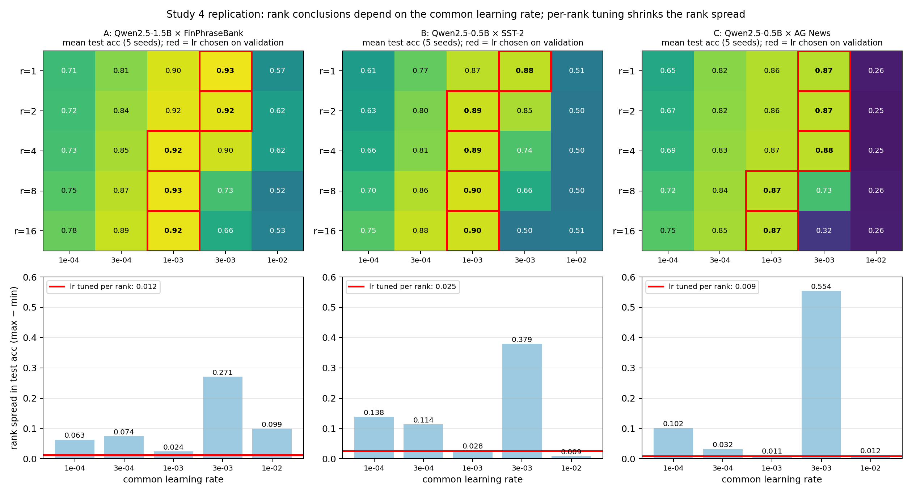

# LoRA rank × learning rate

Code, pre-registrations and raw results for a study of how the learning rate affects the conclusions of LoRA rank ablations.

**Question.** LoRA rank ablations usually train every rank at one shared learning rate. Do their conclusions reflect rank, or how well that learning rate suits each rank?

**Main findings** (Qwen2.5-0.5B/1.5B, n = 500 labelled examples, 5 ranks × 5 learning rates):

- **Which rank "wins" depends on the learning rate.** On Financial PhraseBank, r = 16 beats r = 1 by 0.095 test accuracy at lr 3e-4. At lr 3e-3, r = 1 beats r = 16 by 0.274.
- **Tuning the learning rate per rank on validation removes most of the apparent rank effect.**
  - Confirmatory study: the spread across ranks fell from 0.095 to 0.010.
  - Replications: the spread fell to 17–29% of the median fixed-learning-rate spread, across model scale (1.5B) and tasks (SST-2, AG News).
- **The preferred learning rate falls with rank in every setting**, roughly as r^-0.4.
- **A fixed learning rate is not always misleading.** At lr 1e-3 the spread across ranks was already small in all settings.



A manuscript is in preparation; this repository contains code and data only.

## Studies

| Study | Role | Setting | Runs |
|---|---|---|---|
| 1–2 | Exploratory: how the hypothesis emerged (data scaling, lr sweep, matched step budget) | Qwen2.5-0.5B, Financial PhraseBank | — |
| 3 | Pre-registered confirmatory 5 × 5 grid, 3 seeds | Qwen2.5-0.5B, Financial PhraseBank | 75 LoRA + 30 full FT |
| 4 | Pre-registered replication, 5 seeds | A: 1.5B × FPB · B: 0.5B × SST-2 · C: 0.5B × AG News | 375 |

## Repository layout

```
src/              training code
  peft_study.py         data loading for Financial PhraseBank (used by study2_data_scaling.py)
  study2_data_scaling.py  Studies 2–3 harness (resumable, results to JSON)
  study4_replication.py   Study 4 harness (arms A/B/C, seed-major order, blind progress)
notebooks/        Colab notebooks used to run the experiments (outputs stripped)
analysis/         analysis scripts
  study3_prereg_analysis.py     frozen pre-registered analysis, Study 3
  study3_posthoc_sensitivity.py post-hoc sensitivity analyses (labelled as such)
  study4_prereg_analysis.py     frozen pre-registered analysis, Study 4 (v2)
  make_synth*.py, mc_script.py  synthetic worlds and Monte Carlo validation of the tests
  study4_power_check.py         seed-count check used to plan Study 4
  analyse_study2_v4.py          exploratory Study 2 analysis
preregistration/  pre-registration records with script hashes and version history
results/          raw per-run results (JSON) and analysis outputs
figures/          summary figures
tests/            unit tests for the harnesses
```

## Pre-registration

The confirmatory analyses were frozen before the corresponding data were collected. Their SHA-256 hashes are recorded in `preregistration/`:

| Script | sha256 |
|---|---|
| `analysis/study3_prereg_analysis.py` | `8bd47a637e65f7cc635cb5d9432759e75cfc0dcb4ee7907d527b0c696f7b052e` |
| `analysis/study4_prereg_analysis.py` (v2) | `7efa3c31929d665b43b4e7328e005977cb571472509a50c02b099c3263204c35` |

Verify with `shasum -a 256 analysis/study*_prereg_analysis.py`. Deviations and post-hoc analyses are documented in the pre-registration files.

## Reproducing the analyses

No GPU is needed to re-run the analyses on the released results:

```bash
pip install -r requirements.txt
python analysis/study3_prereg_analysis.py results/study2_study3_results.json
python analysis/study4_prereg_analysis.py results/study4_results.json
```

The outputs should match `results/study3/study3_prereg_output.txt` and `results/study4/study4_prereg_output.txt`. Some helper scripts (`make_synth*.py`, `mc_script.py`, `study4_power_check.py`) read `study2_results.json` from the working directory. Copy `results/study2_study3_results.json` under that name first.

## Re-running the experiments

The experiments were run on a free Google Colab T4 GPU.

1. Open `notebooks/Study4_replication.ipynb` (or `Study3_rank_lr.ipynb`) in Colab and select a T4 runtime.
2. Run the cells in order. Results are written to Google Drive after every run, and finished runs are skipped on restart.

Approximate cost is 1 minute per 0.5B run and 3.5 minutes per 1.5B run. Datasets are downloaded from the Hugging Face Hub at run time and are not redistributed here: Financial PhraseBank (`takala/financial_phrasebank`), SST-2 (`stanfordnlp/sst2`) and AG News (`fancyzhx/ag_news`).

Setup used in all main runs:
- LoRA on `q_proj` and `v_proj`, `lora_alpha = 2r`, dropout 0.05.
- AdamW (weight decay 0.01), one-cycle schedule with 10% warm-up, gradient clipping at 1.0, batch size 16.
- 160 steps; early stopping on validation macro-F1 (12 checks, patience 4); fp16 mixed precision.

## Tests

```bash
python tests/test_study4.py   # data splits, stratification, resume logic (no GPU needed)
python tests/test_study2.py   # requires torch
```

## Citation

If you use this code, please cite the repository; a paper reference will be added once available.

## License

Code is released under the MIT License (see `LICENSE`). The datasets keep their original licences.
